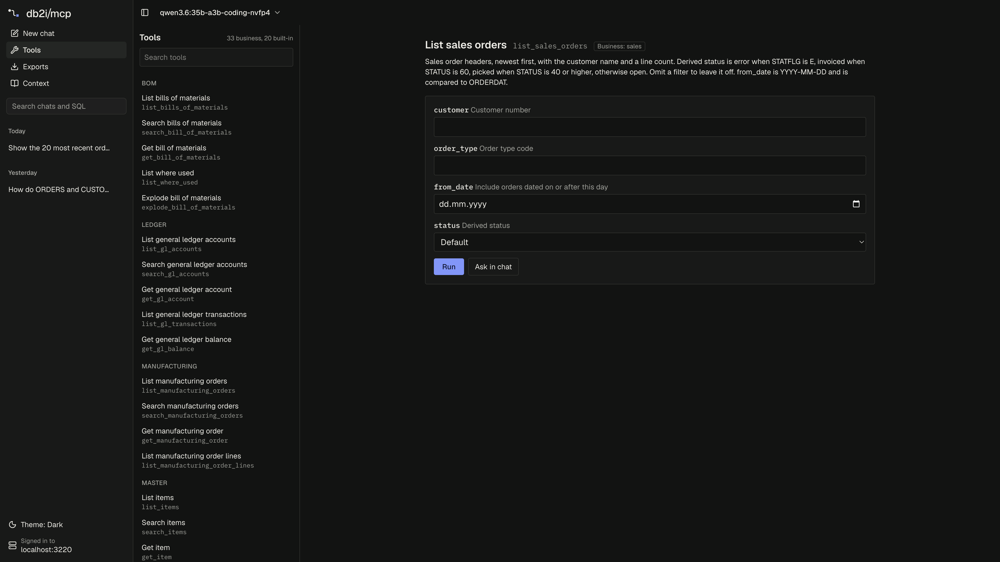
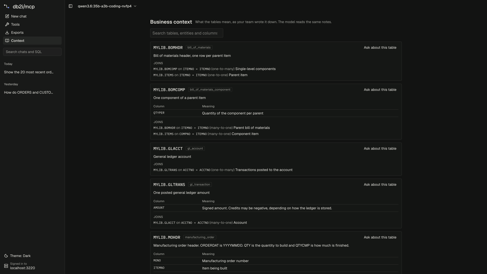

The repository includes an example web app in [`examples/web-app`](https://github.com/Strom-Capital/mcp-server-db2i/tree/main/examples/web-app). It gives people a chat in the browser for questions about IBM i data, without a Claude or ChatGPT subscription and without installing an MCP client.

- Users sign in with their own IBM i user profile, through the server's [OAuth sign-in page](http-transport.md#remote-clients-oauth). Every query runs with that user's authority.
- Users bring their own model API key: Anthropic, OpenAI, Google Gemini, or an OpenAI-compatible endpoint such as Ollama or LM Studio.

It is an example to read, run and change, built with Next.js, [AI SDK](https://ai-sdk.dev) 7, `@ai-sdk/mcp`, [AI Elements](https://ai-sdk.dev/elements) and shadcn/ui. It is not published to npm.

<p align="center">
  
</p>

## What it does

The sidebar lists your chats, newest first and grouped by day, like ChatGPT or Claude. Search finds a chat by its text or by the SQL it ran. Chats are saved in the browser, so each one has its own link (`/c/<id>`) and is still there after a reload.

| Page | What it shows |
|------|---------------|
| Chat | The conversation. Each tool call is a card with its SQL or arguments and the result as a table, and the answer is rendered as markdown |
| Tools | Every tool the server lists, with business SQL tools grouped by toolset. Each tool has a form built from its input schema, so you can run it without the model |
| Exports | Files made by `export_query`, with row count, size, downloads allowed and time left before the link expires. Run an export again to get a fresh link |
| Context | The business context loaded from YAML: what each table means, the filters most queries need, column notes and joins |

The app follows the system's light or dark mode. The theme menu at the bottom of the sidebar overrides it.

Result tables can be sorted by any column, filtered, resized and scrolled through thousands of rows. **Copy for Excel** copies the rows as tab-separated text, and **Download CSV** saves them. Decimals keep every digit the server returned.

<p align="center">
  
</p>

The Tools page lists what the signed-in user can call, so it follows `MCP_TOOLS_ENABLED`, `MCP_CUSTOM_TOOLS` and the profile the user signed in to. A form run is a normal tool call: it goes through the same validator, schema allowlist, rate limit and audit log as a call from the model. **Ask in chat** puts a request for the tool, with the arguments you filled in, into the chat box instead.

<p align="center">
  
</p>

The Context page reads the `db2i://business-context` resource, so it shows exactly what the model gets from `get_business_context`. It stays empty until the server loads table annotations from [`MCP_CUSTOM_TOOLS`](custom-tools.md). **Ask about this table** puts a question about the table in the chat box.

## Run it

You need Node 22 or newer and mcp-server-db2i running over HTTP with OAuth:

```bash
MCP_TRANSPORT=http
MCP_AUTH_MODE=required
MCP_OAUTH_ENABLED=true
MCP_PUBLIC_URL=http://localhost:3000
MCP_OAUTH_SECRET=<openssl rand -hex 32>
# Optional: downloadable Excel and CSV files
EXPORT_ENABLED=true
EXPORT_DIR=/tmp/db2i-exports
```

Then start the app:

```bash
cd examples/web-app
cp .env.example .env.local   # set SESSION_SECRET to openssl rand -base64 32
npm install
npm run dev
```

Open `http://localhost:3001`, choose **Sign in to IBM i**, then **Choose a model** to pick a provider, paste a key and choose a model. The [app's README](https://github.com/Strom-Capital/mcp-server-db2i/tree/main/examples/web-app#readme) lists every setting.

Loopback redirect URIs are always accepted, so local development needs no change to `MCP_OAUTH_REDIRECT_URIS`. For a deployed app, add its callback to the list, and keep the clients you still use, because setting it replaces the defaults:

```bash
MCP_OAUTH_REDIRECT_URIS=https://app.example.com/oauth/callback,https://claude.ai/api/mcp/auth_callback
```

## Switching systems

With [`DB2I_PROFILES`](http-transport.md#multiple-systems) set, the sign-in page asks which system to use. The session is bound to that system: tools have no `system` argument, and the Tools and Context pages show what that profile allows. To use another system, sign out and sign in again.

## Where data goes

- **The IBM i password** goes only to the server's sign-in page. The app never sees it.
- **OAuth tokens** stay on the app's server, in an encrypted, httpOnly session cookie. The browser cannot read them.
- **The model API key** stays in the browser's `localStorage`. Each chat request sends it to the app, which passes it to the provider and does not store or log it.
- **Chats and the list of exports** stay in the browser, in IndexedDB. A saved chat keeps its messages and tool results, so result rows stay on that computer until the chat is deleted.
- **Query results** go to the model provider the user picked, as with any assistant. See [Where data goes](security.md#where-data-goes). With a local model on Ollama, results stay on your network.
