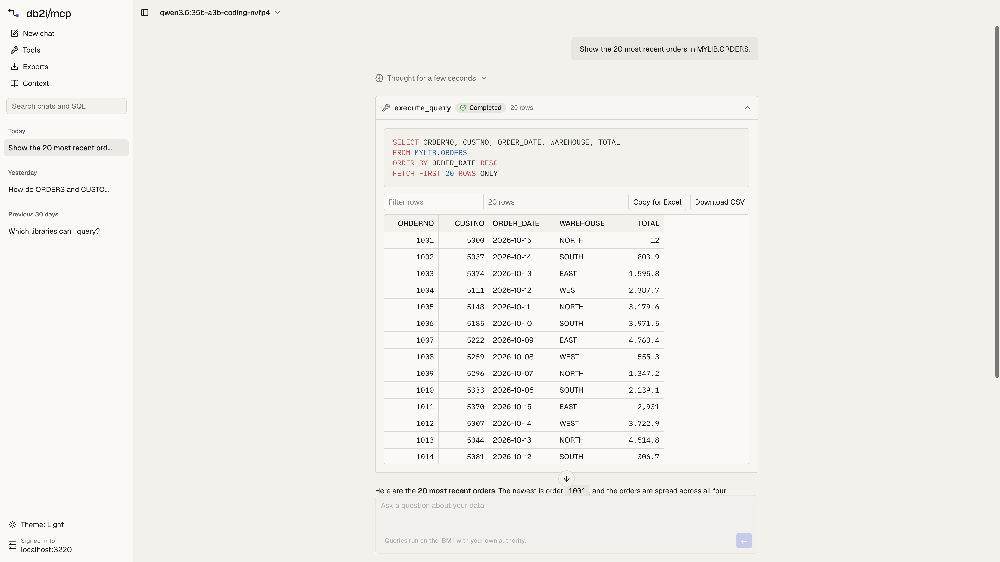

# Example web app

A chat app for [mcp-server-db2i](../../README.md) that runs in the browser. It shows how to build your own web app on top of the MCP server, so people can ask questions about IBM i data without a Claude, ChatGPT or other AI subscription per user. Users sign in with their own IBM i user profile. The model is a pay-as-you-go API key, either one company key set on the app's server or each user's own, or a local model that keeps questions and results inside your network.

It is an example: a starting point to read, run and change. It is not published to npm.

- **Chat** with Anthropic, OpenAI, Google Gemini or any OpenAI-compatible endpoint, including local models in Ollama, LM Studio or vLLM. Answers are rendered as markdown. **Load models** lists the provider's models in a searchable picker, and the effort menu in the chat box sets how long a reasoning model thinks.
- **Saved chats** in a sidebar, grouped by day, as in ChatGPT or Claude. Search them by text or by the SQL they ran. Each chat has its own link and stays in the browser.
- **Result tables** for every query: sort by a column, filter rows, resize columns, scroll through thousands of rows, copy for Excel and export. For an `execute_query` result, Export in the tool card header has the server write every row to Excel or CSV with `export_query`; otherwise it saves the rows the chat holds as CSV. Long decimals keep every digit.
- **Tools**: every tool the server lists, with business SQL tools grouped by toolset. Each one has a form built from its input schema, so you can run it without the model, or send it to the chat.
- **Exports**: `export_query` results show a download button with the row count, size and expiry. The Exports page lists them all, and runs an export again when its link has expired.
- **Context**: the business context from the server's YAML files, with table descriptions, the filters most queries need, column notes and joins.
- **Light and dark themes**, following the system setting unless you pick one.

<picture>
  <source media="(prefers-color-scheme: dark)" srcset="../../docs/assets/web-app-chat-dark.png" />
  
</picture>

More screenshots and an overview are in the [docs](../../docs/web-app.md).

Built with Next.js (App Router), [AI SDK](https://ai-sdk.dev) 7 and AI SDK UI, `@ai-sdk/mcp`, [AI Elements](https://ai-sdk.dev/elements), shadcn/ui, TanStack Table and Streamdown.

## How it works

```text
Browser ──── /api/chat ────▶ Next.js app ──── MCP over HTTP ────▶ mcp-server-db2i ──▶ IBM i
   │                            │  (Bearer token from the session)
   │  model key in a header     └──── model API (Anthropic, OpenAI, ...)
   └── sign-in ──▶ server's OAuth sign-in page
```

- **Sign-in** uses the server's built-in OAuth authorization server. The app registers itself as an OAuth client, sends the user to the server's sign-in page, and keeps the tokens in an encrypted, httpOnly session cookie. The browser never sees the IBM i password or the tokens. Every query runs with the signed-in user's own authority, and the server's checks (read-only validator, schema allowlist, row limits, audit log) apply as usual.
- **Model keys** stay in the browser's `localStorage`. Each chat request sends the key in a header to this app, which passes it to the model provider. The app does not store or log it, and removes it from error messages.
- **Chats** and the list of exports are kept in IndexedDB in the browser. A chat keeps its messages and tool results, result rows included, until it is deleted.
- **Tool forms** call the tool directly through `/api/tools/run`, with the same checks as a call from the model. The form only offers tools the server lists for the signed-in user.
- **Systems**: with `DB2I_PROFILES` on the server, the sign-in page asks which system to use, and the session stays on that system. To switch, sign out and sign in again.

## Run it

You need Node 22 or newer and a running mcp-server-db2i in HTTP mode with OAuth turned on.

1. Start the server with OAuth. From the repository root, add these to your `.env` next to your IBM i connection settings:

   ```bash
   MCP_TRANSPORT=http
   MCP_AUTH_MODE=required
   MCP_OAUTH_ENABLED=true
   MCP_PUBLIC_URL=http://localhost:3000
   MCP_OAUTH_SECRET=<openssl rand -hex 32>
   # Optional: downloadable Excel and CSV files
   EXPORT_ENABLED=true
   EXPORT_DIR=/tmp/db2i-exports
   ```

   Then `npm run build && npm start`. See [HTTP transport](../../docs/http-transport.md#remote-clients-oauth) for the OAuth options.

2. Configure the app:

   ```bash
   cd examples/web-app
   cp .env.example .env.local
   ```

   Set `SESSION_SECRET` to a random string of at least 32 characters, for example `openssl rand -base64 32`.

3. Start the app:

   ```bash
   npm install
   npm run dev
   ```

4. Open http://localhost:3001, choose **Sign in to IBM i**, then **Choose a model** to pick a provider, paste a key (unless the app has its own) and choose a model.

### Settings

| Variable | Required | Description |
|----------|----------|-------------|
| `MCP_SERVER_URL` | Yes | Origin of mcp-server-db2i, such as `http://localhost:3000`. Use the same origin as the server's `MCP_PUBLIC_URL` |
| `APP_URL` | Yes | Origin of this app as users open it, such as `http://localhost:3001`. The OAuth callback is `<APP_URL>/oauth/callback`, and requests from any other origin are refused |
| `SESSION_SECRET` | Yes | Key that encrypts the session cookie, at least 32 characters. Changing it signs everyone out |
| `CUSTOM_MODEL_BASE_URLS` | No | Comma-separated base URLs users may pick for an OpenAI-compatible provider. Default `http://localhost:11434/v1` (Ollama). The app only calls URLs on this list |
| `ANTHROPIC_API_KEY`, `OPENAI_API_KEY`, `GOOGLE_GENERATIVE_AI_API_KEY` | No | A company key for that provider, used for signed-in users who don't enter their own. It stays on the app's server; the browser only learns that a key exists. A key a user enters in Settings is used instead |
| `DEFAULT_PROVIDER`, `DEFAULT_MODEL` | No | The provider (`anthropic`, `openai`, `google` or `openai-compatible`) and model a new user starts with, so they can ask a question without opening Settings. Saved settings in the browser win. Without `DEFAULT_PROVIDER`, a new user starts on the first provider with a server key |

### One key for the whole company

Each user can bring their own key, but you can also set one key on the app's server and let everyone use it. The provider bills per use, so a team shares one API account instead of a subscription per person:

```bash
ANTHROPIC_API_KEY=sk-ant-...
DEFAULT_PROVIDER=anthropic
DEFAULT_MODEL=claude-sonnet-5-5
```

The key is used only for signed-in users: a request without an IBM i sign-in is refused before the provider is called. Users can't read it, and it is kept out of error messages. Every chat still runs with the signed-in user's own IBM i authority. To see and cap the cost, set a spending limit on the provider account the key belongs to.

### Local models

With [Ollama](https://ollama.com) running on the same machine, choose **OpenAI-compatible**, leave the key empty and choose **Load models**. Pick a model that supports tool calling. Small models often call tools badly; results improve a lot with larger ones.

## Deploying it

Run the app on its own HTTPS origin, such as `https://app.example.com`, and the server on another, such as `https://mcp.example.com`.

- Set `APP_URL=https://app.example.com` and `MCP_SERVER_URL=https://mcp.example.com`.
- The server only accepts redirect URIs it knows. Loopback addresses (`http://localhost:<port>`) are always accepted, so local development needs nothing extra. For a deployed app, add its callback to the server's list. Setting `MCP_OAUTH_REDIRECT_URIS` replaces the defaults, so keep the clients you still use:

  ```bash
  MCP_OAUTH_REDIRECT_URIS=https://app.example.com/oauth/callback,https://claude.ai/api/mcp/auth_callback
  ```

- The session cookie is marked `Secure` when `APP_URL` is HTTPS.
- Chat requests stream for up to five minutes (`maxDuration` in `app/api/chat/route.ts`). Make sure the host and any proxy allow that.

## Development

```bash
npm run dev        # http://localhost:3001
npm run typecheck
npm run lint
npm test
npm run build
```

The layout:

- `app/api/chat/route.ts` streams the chat with `streamText` and the server's MCP tools.
- `lib/server/oauth.ts` is the OAuth client: registration, sign-in, token refresh and revoke.
- `lib/server/mcp.ts` opens an MCP client with the session's access token.
- `components/chat-view.tsx` is the chat, `components/app-sidebar.tsx` the sidebar with saved chats, and `components/tool-card.tsx` a tool call in the chat.
- `components/ai-elements/` and `components/ui/` are copied from the AI Elements and shadcn/ui registries. Add more with `npx ai-elements@latest add <name>` or `npx shadcn@latest add <name>`.
- `components/result-table.tsx` is the result table.
- `lib/schema-form.ts` turns a tool's input schema into form fields and arguments, and `components/tool-form.tsx` renders them.
- `lib/server/tools.ts` lists the tools, runs one, and reads the business context.
- `lib/client/store.ts` keeps the chats and exports in IndexedDB, and `lib/chats.ts` titles, searches and groups the chats.
- `app/globals.css` holds the light and dark colors as shadcn theme variables.

Tests mock the MCP server and the model, so they need neither an IBM i nor an API key.
